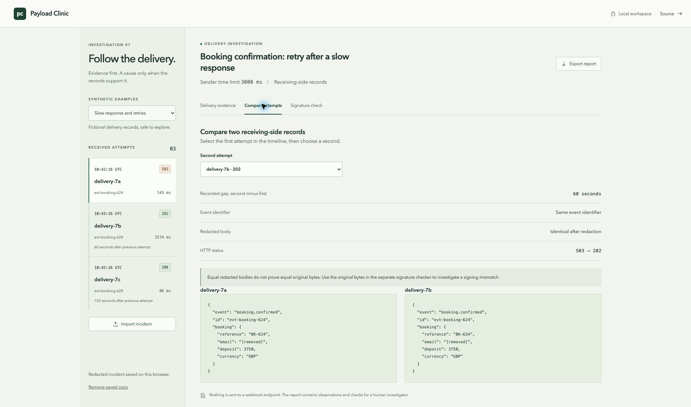
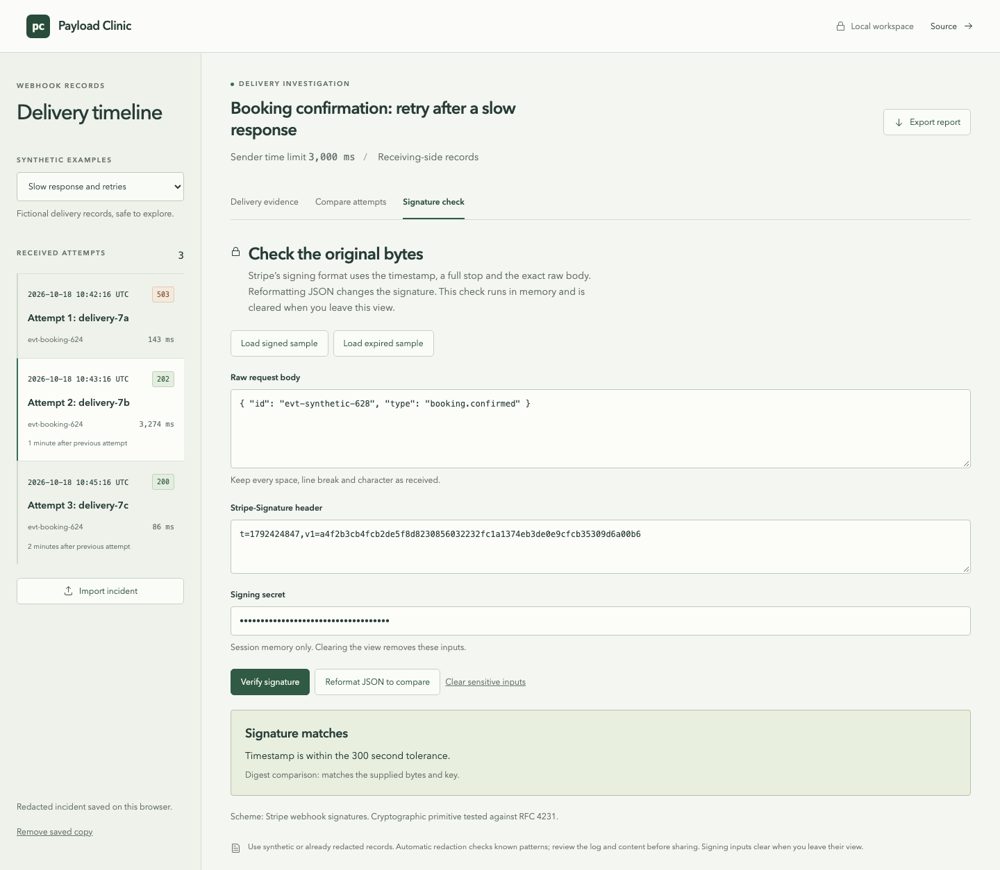

# Payload Clinic

Payload Clinic helps small software support teams explain failed webhook deliveries. Bring synthetic or redacted receiving-side records into one local workspace, compare attempts and prepare an incident report without copying production secrets into an online service.

[Open the demo](https://stigmavlc.github.io/payload-clinic/) · [Run locally](#run-locally) · [Incident format](#incident-format)






## Try a short investigation

1. Open **Slow response and retries**. The first receiving-side record contains a 503 response.
2. Select `delivery-7b`. Its 3,274 ms duration exceeds the supplied 3,000 ms sender time limit. The receiver returned 202, but these records alone do not prove what the sender received or whether downstream work completed.
3. Open **Compare attempts** and compare that record with `delivery-7c`. Check the recorded gap, event identifier, body and response.
4. Export a redacted Markdown report. It contains the records, observations, suggested checks and redaction log, with no signature-checker inputs.
5. In **Signature check**, load a signed synthetic sample and verify it. Reformat the JSON and verify again to see why the original bytes matter. The expired sample demonstrates the separate timestamp check.

The second incident, **Changed request contract**, contains malformed JSON followed by a 422 response about a field type. Use it to practise checking the payload against the endpoint contract and deciding which receiving-side evidence to request next.

## What it does

- Validates incident structure before import, with clear errors for malformed input.
- Orders receiving-side records by timestamp and shows gaps between attempts.
- Separates HTTP status observations from investigation checks, including slow responses and repeated event identifiers.
- Compares event identifiers, timing, HTTP status and request bodies after redaction.
- Redacts recognised secret fields, credential patterns and email addresses before browser storage or report export.
- Verifies Stripe-style HMAC SHA-256 signatures using the original UTF-8 body and timestamp, with a five-minute tolerance.

The examples are fictional. Observations describe the supplied records; investigation checks identify the evidence still needed from the sender or receiver.

## Data handling

Use synthetic or already redacted records and inspect the result before sharing it. Input stays in the browser. The static host receives normal page and asset requests; incident and signature inputs remain local.

The importer removes header, JSON and form values whose field names contain authorization, cookie, signature, token, secret, password, API key or email. Nulls, booleans and empty strings remain as recorded under these names and create no removal entry. Every other value under a recognised sensitive name is removed. It also checks text for email addresses, JWTs, Stripe API keys and webhook secrets, long Bearer credentials with digits or mixed token characters, and Basic credentials that decode to a user and password. Recognised credentials found in sensitive fields are checked for repeated appearances elsewhere in the incident.

JSON and form bodies keep their source formatting outside the fields and values removed. Other bodies remain text. Unknown incident properties are discarded. The redaction log uses the chronological attempt numbers shown in the timeline and report.

These checks cover particular patterns. Names, addresses, encoded values, unfamiliar credential formats and private business details can remain. Review both the log and the remaining content before sharing a report.

The redacted incident and its complete log are saved in `localStorage` under `payload-clinic.incident.v1`. This storage is unencrypted and readable by scripts on the same origin. Saved records may be larger than their source file because replacement labels and log entries take space. If the browser refuses a save, the workspace tells you to export before closing. If a saved record cannot be reopened, it is kept unchanged and a warning appears above the storage controls. Importing another incident replaces that saved copy. Switching between the built-in examples keeps an unreadable saved copy unchanged. **Remove saved copy** deletes it while leaving the current view in memory. Clearing site storage also removes it.

Signing inputs use separate, temporary component memory. Leaving **Signature check** or pressing **Clear sensitive inputs** clears them. Storage and reports contain incident evidence only. A digest match confirms the supplied key and bytes; the timestamp must also pass the five-minute check. Event authenticity and successful processing require evidence from the production systems.

## Incident format

Import a JSON file or paste a JSON object. The whole file is limited to 1 MB, with 1 to 100 attempts and a title of 1 to 180 characters. Unknown properties are ignored. Header names map to strings. Attempt identifiers must remain unique after redaction; use distinct labels that contain no personal details. Event identifiers may repeat when the original identifiers are identical. If redaction would merge different event identifiers, import stops with an error. Replace those identifiers with distinct labels before importing, using the same label only for records of the same event.

```json
{
  "title": "Booking confirmation investigation",
  "senderTimeoutMs": 3000,
  "attempts": [
    {
      "id": "delivery-01",
      "eventId": "evt-booking-624",
      "receivedAt": "2026-10-18T10:42:16Z",
      "status": 503,
      "durationMs": 143,
      "headers": { "content-type": "application/json" },
      "requestBody": "{\"id\":\"evt-booking-624\"}",
      "responseBody": "{\"error\":\"upstream_unavailable\"}"
    }
  ]
}
```

`receivedAt` needs an ISO timestamp with a time zone. `status` is an integer from 100 to 599, or `null` if no HTTP response was recorded. Durations cannot be negative. Supply the sender’s documented positive time limit in `senderTimeoutMs`. Bodies are strings so malformed JSON can be retained as evidence.

## Run locally

Use Node.js 22 and npm.

```sh
npm ci
npm run dev
```

Open the local address printed by Vite, including `/payload-clinic/`.

```sh
npm test
npm run build
npx playwright install chromium
npm run test:browser
```

For Linux environments without browser system libraries, use `npx playwright install --with-deps chromium`. The browser tests start their own local Vite server on port 4173. `npm run preview` serves a production build.

## Verification

Unit tests exercise ordering and retry intervals, status interpretation, validation, redaction, storage recovery and report output. They cover large batches of email events, encoded attachments, original body formatting and numeric identifiers. Signature tests use RFC 4231 and the Stripe signing format, including changed bytes, malformed headers and expired timestamps.

Browser tests follow an investigation through import, reload and export, then check transient signing inputs, keyboard navigation, spacing and a 390 px layout. CI runs the unit tests, production build and Chromium tests before publishing that commit to GitHub Pages.

Screenshots show the application running with synthetic records at 1440 px. Run `CAPTURE_DOCS=1 npm run test:browser -- --grep "capture the three"` to refresh them in `docs/screenshots/`.

## Design and implementation

React and TypeScript provide a small static application. Vite builds it; Tailwind CSS and local styles provide the layout; Radix icons identify actions without a remote icon service. All fonts use the system stack.

- `src/incident.ts`: import validation, redaction, observations, comparisons and report generation.
- `src/signature.ts`: Web Crypto HMAC and Stripe header verification.
- `src/SignaturePanel.tsx`: short-lived signing inputs and synthetic examples.
- `src/main.tsx`: timeline, import, persistence and views.
- `tests/`: unit and browser verification.
- `.github/workflows/ci.yml`: verification and GitHub Pages publication.

The application is static and can be served from GitHub Pages. All investigation and cryptographic calculations run in the browser.

## References

- [Stripe: verify webhook signatures](https://docs.stripe.com/webhooks/signature)
- [RFC 4231: HMAC SHA-256 test vectors](https://www.rfc-editor.org/rfc/rfc4231)
- [MDN: Web Crypto sign](https://developer.mozilla.org/en-US/docs/Web/API/SubtleCrypto/sign)

## Licence

MIT. Copyright 2026 Ivan Aguilar.
