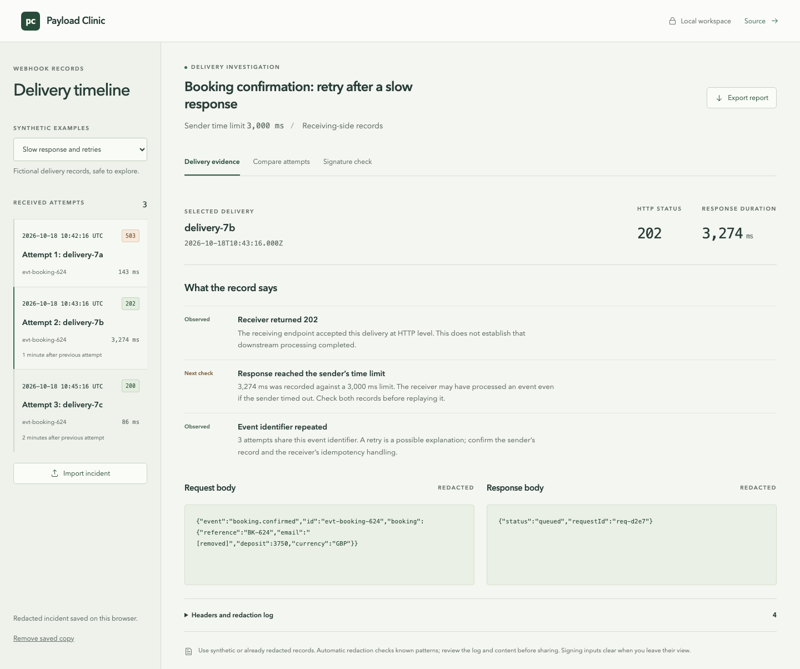

# Payload Clinic

Payload Clinic helps small software support teams explain failed webhook deliveries. Bring synthetic or redacted receiving-side records into one local workspace, compare attempts and prepare an incident report without copying production secrets into an online service.

[Open the demo](https://stigmavlc.github.io/payload-clinic/) · [Run locally](#run-locally) · [Incident format](#incident-format)



## Try a short investigation

1. Open **Slow response and retries**. The first receiving-side record contains a 503 response.
2. Select `delivery-7b`. Its 3,274 ms duration exceeds the supplied 3,000 ms sender time limit. The receiver returned 202, but these records alone do not prove what the sender received or whether downstream work completed.
3. Open **Compare attempts** and compare that record with `delivery-7c`. Check the recorded gap, event identifier, body and response.
4. Export a redacted Markdown report. It contains the records, observations, suggested checks and redaction log, with no signature-checker inputs.
5. In **Signature check**, load a signed synthetic sample and verify it. Reformat the JSON and verify again to see why the original bytes matter. The expired sample demonstrates the separate timestamp check.

The second incident, **Changed request contract**, contains malformed JSON followed by a 422 response. It helps distinguish a syntax observation from a server response about a field's type. The tool does not invent an endpoint contract or claim to know the root cause.

## What it does

- Validates incident structure before import, with clear errors for malformed input.
- Orders receiving-side records by timestamp and shows gaps between attempts.
- Separates HTTP status observations from investigation checks, including slow responses and repeated event identifiers.
- Compares two redacted request bodies without treating equality after redaction as proof of identical original bytes.
- Redacts recognised secret fields, credential patterns and email addresses before browser storage or report export.
- Verifies Stripe-style HMAC SHA-256 signatures using the original UTF-8 body and timestamp, with a five-minute tolerance.
- Works by keyboard, including a focus-contained import dialog, Escape to close and restored focus.
- Adapts to a narrow screen without page-wide horizontal scrolling.

The examples are fictional. This is a receiving-side evidence tool: it does not contact an endpoint, replay an event, predict a sender's retry schedule or replace server logs.

## Data handling

Use synthetic or already redacted records. The application makes no network requests with incident or signing inputs. Its static host can still receive normal requests for the page and assets. Following the source or reference links opens external sites.

The importer recognises sensitive field names such as `Authorization`, `Cookie`, `Stripe-Signature`, token, secret, password, API key and email. It also removes email patterns, bearer credentials, JWT-shaped strings, Stripe `sk_`, `pk_`, `rk_` live/test keys and `whsec_` signing secrets. JSON fields and form-encoded `key=value&key=value` bodies are checked for sensitive names. Repeated credentials include Bearer/Basic values and Stripe v1 digests extracted from headers. Repeated matching requires at least 12 characters with a number, uppercase letter or credential punctuation, and respects token boundaries. Field names receive email and credential-pattern checks only. Recognised values are removed from titles, identifiers, headers and bodies. Unknown incident properties are discarded.

Redaction is a practical filter, not an anonymisation guarantee. It cannot recognise every personal name, address, encoded value, arbitrary credential or private business detail. Inspect the redacted content and its log before sharing. Invalid JSON bodies remain useful evidence and are scrubbed as text.

Only the redacted incident is stored in `localStorage`, under `payload-clinic.incident.v1`. Browser storage is unencrypted and available to other scripts on the same origin. **Remove saved copy** deletes the stored incident; the current view remains in memory until the page closes or a different incident is loaded. Importing or choosing an example saves that new redacted incident again. Clearing site storage also removes the saved copy.

The signature checker is separate. Its raw body, signature header and secret stay in component memory, are never included in storage or exports, and clear when leaving that view or pressing **Clear sensitive inputs**. Use its synthetic examples rather than live credentials. A matching signature establishes that the supplied bytes and key match, not that the event was authorised or processed successfully.

## Incident format

Import a JSON file or paste a JSON object. The whole file is limited to 1 MB, with 1 to 100 attempts and a title of 1 to 180 characters. Unknown properties are ignored. Header names map to strings. Attempt identifiers must be unique; event identifiers may repeat.

```json
{
  "title": "Booking confirmation investigation",
  "senderTimeoutMs": 3000,
  "attempts": [
    {
      "id": "delivery-01",
      "eventId": "evt-booking-624",
      "receivedAt": "2026-10-18T10:42:16Z",
      "status": 503,
      "durationMs": 143,
      "headers": { "content-type": "application/json" },
      "requestBody": "{\"id\":\"evt-booking-624\"}",
      "responseBody": "{\"error\":\"upstream_unavailable\"}"
    }
  ]
}
```

`receivedAt` needs an ISO timestamp with a time zone. `status` is an integer from 100 to 599, or `null` if no HTTP response was recorded. Durations cannot be negative. `senderTimeoutMs` must be a known positive limit from the sender, not an inferred default. Bodies are strings so malformed JSON can be retained as evidence.

## Run locally

Use Node.js 22 and npm.

```sh
npm ci
npm run dev
```

Open the local address printed by Vite, including `/payload-clinic/`.

```sh
npm test
npm run build
npx playwright install chromium
npm run test:browser
```

For Linux environments without browser system libraries, use `npx playwright install --with-deps chromium`. The browser tests start their own local Vite server on port 4173. `npm run preview` serves a production build.

## Verification

The test suite covers chronological ordering, status interpretation, sender time limits, invalid JSON, malformed import structures, duplicate identifiers, redaction across bodies and nested object keys, repeated secrets and report content. Cryptographic tests include RFC 4231 test case 1 and the supplied Stripe signing format, with changed bytes, missing or malformed signatures and expired timestamps.

Browser tests exercise a complete investigation and export, invalid and valid imports with redacted persistence across reload, transient signature inputs, a 390 px layout, and keyboard focus containment and restoration. CI installs dependencies, runs the unit tests, builds the app and runs Chromium tests. Publishing depends on that verification job succeeding for the same commit.

Screenshots show the application running with synthetic records. They are saved in `docs/screenshots/`.

## Design and implementation

React and TypeScript provide a small static application. Vite builds it; Tailwind CSS and local styles provide the layout; Radix icons identify actions without a remote icon service. All fonts use the system stack.

- `src/incident.ts`: import validation, redaction, observations, comparisons and report generation.
- `src/signature.ts`: Web Crypto HMAC and Stripe header verification.
- `src/SignaturePanel.tsx`: short-lived signing inputs and synthetic examples.
- `src/main.tsx`: timeline, import, persistence and views.
- `tests/`: unit and browser verification.
- `.github/workflows/ci.yml`: verification and GitHub Pages publication.

The app deliberately does not accept arbitrary executable templates, fetch remote payloads, issue webhook requests or store signing secrets. It has no backend, account or telemetry SDK.

## References

- [Stripe: verify webhook signatures](https://docs.stripe.com/webhooks/signature)
- [RFC 4231: HMAC SHA-256 test vectors](https://www.rfc-editor.org/rfc/rfc4231)
- [MDN: Web Crypto sign](https://developer.mozilla.org/en-US/docs/Web/API/SubtleCrypto/sign)

## Licence

MIT. Copyright 2026 Ivan Aguilar.
